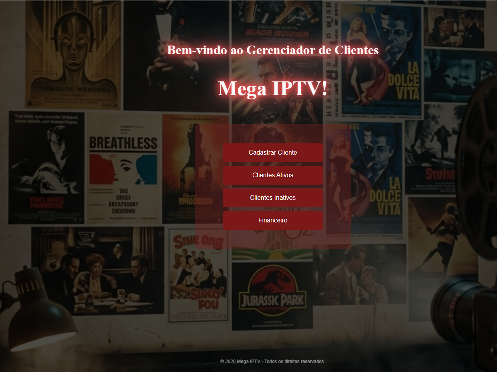
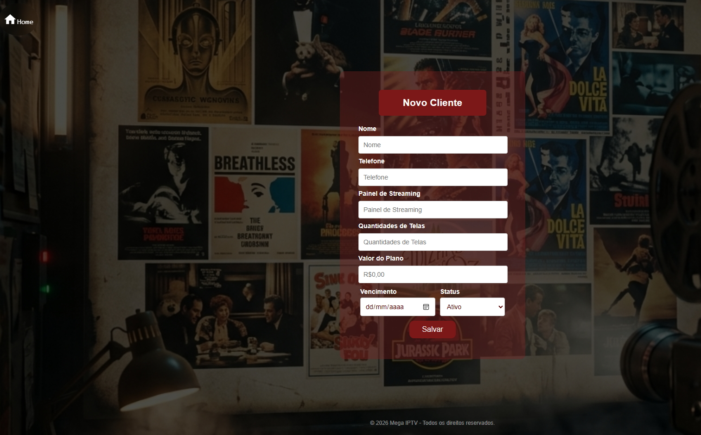

# 🎬 Gerenciador de Clientes - Mega IPTV

Um sistema desenvolvido para facilitar o gerenciamento de clientes de streaming, oferecendo controle prático sobre assinaturas, status de usuários e gestão financeira.

## 🚀 Funcionalidades

A interface atual já conta com os seguintes módulos:
- **Cadastrar Cliente:** Registro de novos usuários no sistema.
- **Clientes Ativos:** Listagem e controle de assinantes com pagamentos em dia.
- **Clientes Inativos:** Monitoramento de assinaturas vencidas, suspensas ou canceladas.
- **Financeiro:** Gestão de pagamentos, cobranças e fluxo de caixa.

## 💻 Tecnologias Utilizadas
- **Backend:** Java com Spring Boot
- **Frontend:** HTML, CSS e JavaScript
- **Controle de Versão:** Git e GitHub

## 📸 Interface do Sistema




## 🔄 Histórico de Atualizações (Changelog)

Aqui documentarei a evolução do projeto:

- **07/11/2026:** Upload inicial da estrutura do projeto. Backend (Spring Boot) e interface principal criados com os menus de navegação.
- **[Próxima Atualização]:**Integração da tela de cadastro com o banco de dados*.

## ⚙️ Como Executar o Projeto Localmente

1. Clone este repositório:
   ```bash
   git clone [https://github.com/giliane-23/gerenciador-streaming.git](https://github.com/giliane-23/gerenciador-streaming.git)